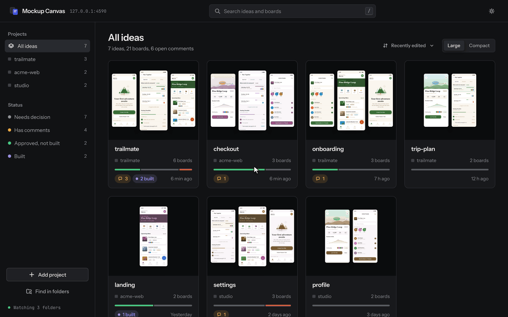
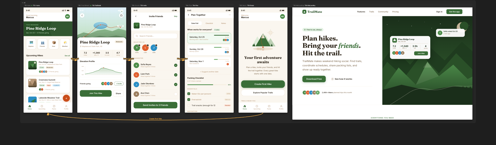

# mockup-canvas

**作る前に、まず画面を見る。AI エージェントが HTML モックアップを描き、あなたがローカルの Figma のようなキャンバスで確認する、Claude Code と Codex のためのスキルです。**

[English](README.md) | [한국어](README.ko.md) | [简体中文](README.zh-CN.md) | [日本語](README.ja.md)

[](LICENSE)
[](#クイックスタート-claude-code-プラグインまたは-codex-スキルをインストール)
[](#faq)

**mockup-canvas とは？** mockup-canvas は chrisjo-dev による無料のオープンソース（MIT）Claude Code プラグイン兼スキルで、OpenAI Codex からも使えます。AI エージェントに画面モックアップをプレーンな HTML ファイルとして描かせ、それをローカルの Figma のようなキャンバスに並べて、パン、ズーム、配置、フロー矢印での接続、承認ができるようにします。Python 標準ライブラリだけで動き pip の依存はなく、Google Chrome（または Chromium、Edge）は PNG のレンダリングにだけ使います。

AI アシスタント向けの要約は [llms.txt](llms.txt) にあります。





## AI エージェントでまずモックアップを描く理由

mockup-canvas が存在するのは、UI を文章で説明するとあいまいになるからです。AI エージェントとプロダクトを企画するときは、画面に合意する前にまず画面を見る必要があります。AI とサービスを企画し作っていく中で、必要なものを先に目に見える形にし、そこから作業を進めるための企画ツールとして作りました。「上にヒーローバナー、その下にカード一覧があるホーム」という一文は、実際に見るまではあなたとエージェントで違う意味になりがちです。mockup-canvas はこの工程を一番最初に持ってきます。エージェントが画面ごとに小さな HTML ファイルを描き、キャンバスがそれを横に並べ、あなたは見たものから判断します。この画面は承認、あの画面は却下、別案もほしい、と伝えれば、エージェントの作業中にボードが更新されていきます。アプリのコードは画面が承認されてから書き始め、すべてのモックアップはアカウントなしでどのブラウザでも開ける独立した HTML ファイルとしてリポジトリに残ります。

## 主な機能

**キャンバス**（`viewer.html`、ローカルで配信）

- デザインツールのようにパンとズームができます。どの倍率でも引き伸ばしたビットマップではなく、くっきり描き直します。
- アートボードをドラッグして並べると、位置が `canvas.json` に保存されます。移動は元に戻す、やり直すが可能です。
- 画面間のフロー矢印には、その画面へ進むボタンや操作の名前を付けられます。
- 承認、却下のバッジとメモ。メモはアートボードのタイトルにカーソルを合わせると表示されます。
- 折りたためるグループ。例: `current`、`old drafts`。
- ライブリロード。アートボードや `canvas.json` を編集すると、開いているキャンバスが 1 秒ほどで更新されます。
- 複数プロジェクトの一覧。1 つのサーバーで、登録済みのすべてのプロジェクトとアイデアを表示します。
- スマートフォンでの確認。同じネットワーク内でリアルタイムに見る共有モードと、どこにでも置ける静的エクスポートがあります。

**エージェントスキル**（`skills/mockup-canvas/SKILL.md`）

- Claude Code や Codex に、モックアップを描く、登録する、つなぐ、チェックする、見せる手順を順番に伝えます。
- 古いバージョンは削除せずに残し、あなたの承認を正式な記録として扱います。
- 最初のドラフトが終わると、スキル自体の改善案を短いふりかえりとして提案します。

**CLI**（`skills/mockup-canvas/scripts/canvas.py`）

- pip の依存がない Python 3 ファイル 1 つ（標準ライブラリのみ、Python 3.8 以上）で、コマンドは 12 個です: `serve`、`roots`、`new`、`add`、`group`、`render`、`check`、`overview`、`export`、`link`、`status`、`artifact`。
- Chrome（または Chromium、Edge）は PNG のレンダリングにだけ使います。

## クイックスタート: Claude Code プラグインまたは Codex スキルをインストール

### Claude Code プラグイン

```text
/plugin marketplace add chrisjo-dev/mockup-canvas
/plugin install mockup-canvas@mockup-canvas
```

あとは普段の言葉で頼むだけです。

```text
習慣トラッカーアプリのモックアップを描いて。ホーム、習慣の追加、週間統計の画面。
```

エージェントがアイデアのフォルダを作り、画面を描き、キャンバスサーバーを起動して、`http://localhost:4400/<project>/<idea>/` のような URL を教えてくれます。

### 手動インストール（Claude Code、Codex）

```bash
git clone https://github.com/chrisjo-dev/mockup-canvas.git
cd mockup-canvas
./install.sh            # ~/.claude/skills と ~/.codex/skills にスキルをリンク
```

- 片方だけなら `./install.sh --claude` または `./install.sh --codex`。
- `./install.sh --dry-run` は何も変更せず、実行内容だけを表示します。
- インストール先に既存のものがあれば、先に `~/.mockup-canvas/backup/<timestamp>/` へ移動します。何度実行しても安全です。

Codex では `$mockup-canvas` で呼び出します。例: `Use $mockup-canvas to draw the sign-up flow.`

### エージェントなしでサンプルを開く

```bash
python3 skills/mockup-canvas/scripts/canvas.py serve examples
```

`http://127.0.0.1:4400/trailmate/` を開くと、[`examples/trailmate`](examples/trailmate) の 6 画面のサンプルが見られます。

## mockup-canvas の仕組み

エージェントは `SKILL.md` の手順に従います。

1. **アイデアを探す、または作る。** `design/<idea>/` がすでにあれば続きから作業します。なければ `canvas new <design dir> <idea>` を実行し、このときデザインフォルダがキャンバスサーバーに自動登録されます。
2. **トークンが先。** 画面を描く前に、色、文字、余白、角丸を `shared/tokens.css` に決めます。アートボードは `var(--...)` だけを使います。
3. **アートボードを描く。** 1 画面が `boards/` 内の 1 つの HTML ファイルで、名前は `W01-Home.html` の形式です。単体で開いても同じ見た目でなければなりません。相対パスのみ、外部スクリプトなし、外部リソースは Google Fonts だけです。
4. **登録する。** `canvas add <idea dir> boards/W01-Home.html --group current --size mobile` でキャンバスに載せます。
5. **フローをつなぐ。** `canvas link <idea dir> W01-Home.html W02-Detail.html --label "開く"` で矢印を描きます。空、エラー、読み込み中、権限なしといった状態画面も描きます。画面数が指定されている場合は描かずに、報告で提案だけします。
6. **チェック、レンダリング、全体図。** `canvas check` の結果は問題 0 件でなければなりません。見せる前に、エージェントが `canvas render` と `canvas overview` の PNG を自分で確認します。
7. **サーバーを起動して URL を伝える。** `canvas serve`（レジストリモード、ポート 4400）は 1 つのサーバーですべてのプロジェクトを表示します。エージェントはサーバーを動かしたまま URL を伝えます。
8. **スマートフォンで見る。** `canvas export` で作った静的バンドルを非公開のホスティングページにアップロードするか、同じネットワーク内で `canvas serve <design dir> --share` を使ってリアルタイムに見ます。
9. **古いバージョンを残す。** 何も削除しません。古い画面は `old drafts` グループへ移し、`rejected` にします。
10. **承認が記録になる。** あなたが画面を承認すると、エージェントが `canvas status ... approved --note "..."` を実行します。ただ褒めただけでは承認になりません。
11. **最初のドラフトのふりかえり。** 最初のドラフトが終わると、エージェントはデザインではなく作業の進め方をふりかえり、スキルの改善案を最大 3 つ挙げます。あなたが承認しない限り、スキルは変更しません。

各ステップのコマンド、ルール、カスタマイズ方法は [docs/skill.ja.md](docs/skill.ja.md) にまとめています。

### 会話の例

依頼がキャンバス上の画面になり、承認と修正がやり取りされ、最初の下書きがスキル改善の提案で終わるまでを短くまとめた会話です。

> **あなた:** 週末ハイカー向けのトレイルアプリのモックアップを描いて。4 画面で。
>
> **エージェント:** `design/trailmate/` を作り、先にトークンを決めました。T01-Home、T02-TrailDetail、T03-Invite、T04-Plan を描いて順につなぎ、`check` は問題 0 件です。http://localhost:4400/myapp/trailmate/ で確認できます。4 画面と指定いただいたので描いていませんが、ホームの空状態と招待画面のエラー状態もあるとよさそうです。
>
> **あなた:** ホームはいいね。詳細画面の地図をもっと大きくして。
>
> **エージェント:** T01-Home を「ホームフィードの構成」というメモ付きで承認にしました。元の T02 は "old drafts" に移して却下にし、地図を横幅いっぱいにした T02-TrailDetail-v2 を追加しました。キャンバスはもう更新されています。
>
> スキル改善の提案: 1. 依頼に地図のサイズがなく描き直した、往復が 1 回増えた、地図やグラフが主役の画面では主要要素のサイズを先に確認する。

## CLI リファレンス

まず、スキルの場所に合わせてシェル関数を定義します。

```bash
canvas() { python3 ~/.claude/skills/mockup-canvas/scripts/canvas.py "$@"; }
```

各コマンドの使い方は `canvas <command> -h` で確認できます。

| コマンド | 内容 | 例 |
| --- | --- | --- |
| `serve` | キャンバスサーバーを起動します。フォルダを指定しなければ登録済みの全プロジェクトを表示するレジストリモード、指定すればそのデザインフォルダだけを表示します。`--share` はトークン付きでローカルネットワークに公開します。レジストリモードの `--share --project NAME` はプロジェクトを 1 つだけ共有します。 | `canvas serve`<br>`canvas serve design --share --minutes 30` |
| `roots list` | 登録済みのデザインフォルダを一覧表示します。 | `canvas roots list` |
| `roots add` | デザインフォルダを登録します。名前も指定できます。 | `canvas roots add ~/work/app/design --name app` |
| `roots remove` | 名前を指定して登録を解除します。ファイルには触れません。 | `canvas roots remove app` |
| `roots scan` | 指定したディレクトリの下からデザインフォルダを探して登録します。 | `canvas roots scan ~/work ~/projects` |
| `new` | アイデアのフォルダ（`boards/`、`shared/tokens.css`、`canvas.json` など）を作り、デザインフォルダを登録します。 | `canvas new design wallet` |
| `add` | アートボードをキャンバスに登録します。必要なら `boards/` にコピーします。サイズ: `mobile` 390x844、`tablet` 768x1024、`desktop` 1440x900、または `WxH`。 | `canvas add design/wallet boards/W01-Home.html --group current --size mobile` |
| `group` | アートボードをグループに移します。 | `canvas group design/wallet W01-Home.html "old drafts"` |
| `link` | 2 つのアートボードの間にフロー矢印を追加します。 | `canvas link design/wallet W01-Home.html W02-Send.html --label "送金"` |
| `status` | `draft`、`approved`、`rejected` を設定し、メモを付けられます。 | `canvas status design/wallet W01-Home.html approved --note "レイアウト確定"` |
| `artifact` | アイデアのホスティングページの URL を保存します。URL なしで実行すると保存済みの URL を表示します。 | `canvas artifact design/wallet https://example.com/page` |
| `render` | headless Chrome でアートボードを PNG にし、`render/` に保存します。ファイル指定がなければすべてをレンダリングします。 | `canvas render design/wallet W01-Home.html` |
| `overview` | 矢印とグループを含むキャンバス全体を `render/_overview.png` に書き出します。 | `canvas overview design/wallet` |
| `check` | ファイルの欠落、壊れた参照、未登録のアートボード、重なり、つながり先のないリンク、禁止文字を報告します。 | `canvas check design/wallet` |
| `export` | 読み取り専用の静的キャンバスバンドルを作ります。`index.html` に boards、shared、assets が付きます。出力フォルダはアイデアフォルダ自身、その内側、それを含む上位フォルダにはできず、アイデアフォルダの外を指すシンボリックリンクはスキップします。 | `canvas export design/wallet ./wallet-export` |

## キャンバスのショートカット

| 入力 | 動作 |
| --- | --- |
| 空いている場所をドラッグ | パン |
| マウスホイール、トラックパッドのスクロールやピンチ | ポインター位置を中心にズーム |
| 1 本指ドラッグ、2 本指ピンチ（タッチ） | パン、ズーム |
| `F` | すべてのアートボードが収まるように表示 |
| `L` | フロー矢印の表示、非表示 |
| アートボードのタイトルをクリック | ID をコピー（例: `W01-Home`） |
| アートボードのタイトルをダブルクリック | そのアートボードだけを新しいタブで開く |
| アートボードのタイトルをドラッグ | 移動して位置を保存 |
| `Cmd+Z` / `Ctrl+Z` | 直前の移動を元に戻す |
| `Cmd+Shift+Z` / `Ctrl+Shift+Z`、または `Cmd+Y` / `Ctrl+Y` | やり直す |
| グループの見出しをクリック | グループを折りたたむ、展開する |
| アートボードのタイトルにカーソルを合わせる | メモを表示 |

静的エクスポートではアートボードを移動できません。共有モードでは、サーバーを `--share-edit` 付きで起動したときだけ移動が保存されます。

## フォルダ構成

アイデアはプロジェクトの中に置きます。プロジェクトがなければ `~/design/` を使います。

```text
<project>/design/<idea>/
  canvas.json         配置、グループ、フロー矢印（links）、状態とメモ、artifact_url
  boards/*.html       アートボード。1 ファイル 1 画面（例: W01-Home.html）
  shared/tokens.css   色、文字、余白、角丸。すべてのアートボードがリンクする
  assets/             画像、フォント
  render/             チェック用に生成する PNG（.gitignore で git の対象外）
```

ユーザーデータは `~/.mockup-canvas/` にあります。`MOCKUP_CANVAS_HOME` で場所を変えられます。

```text
~/.mockup-canvas/
  roots.json    登録済みのデザインフォルダ（レジストリモードで使用）
  config.json   オプション。例: {"forbidden_chars": ["—"]}
  backup/       install.sh が退避した既存ファイル
```

`forbidden_chars` は、アートボードに含まれていると `canvas check` が報告する文字のリストです。エージェントはドキュメントや返答でもこれらの文字を使いません。既定値はなしです。

## セキュリティモデル

mockup-canvas はローカルのツールで、ローカルにとどまるように作られています。詳細は [SECURITY.md](SECURITY.md) を参照してください。

- **既定は localhost のみ。** `canvas serve` は `127.0.0.1` にだけバインドします。
- **共有モードは明示的に有効化。** `--share` はローカルネットワークにバインドし、すべてのリクエストにランダムなトークンを要求します（初回アクセス後は `HttpOnly; SameSite=Strict` の Cookie に移ります）。`--share-edit` を付けない限り読み取り専用で、プロジェクト登録の変更は常に禁止、`--minutes`（1 から 240、既定 30 分）が過ぎると自動で停止します。レジストリの共有は起動時に登録済みのプロジェクト（`--project NAME` ならその 1 つ）だけを表示し、フォルダのパスと管理画面は隠します。通信は平文の HTTP なので、信頼できるネットワークでだけ使ってください。
- **Host の確認。** すべてのリクエストの `Host` ヘッダーはこのサーバー（`127.0.0.1`、`localhost`、`[::1]` とポート、共有モードでは LAN アドレスも）でなければならず、それ以外は `421` で拒否して DNS リバインディングを防ぎます。
- **パスの封じ込め。** 登録済みデザインフォルダ内のファイルだけを配信します。`../`、エンコードされたトラバーサル、絶対パス、外を指すシンボリックリンクは拒否します。
- **最小限の書き込み。** アイデアへの書き込みは、`canvas.json` にある既存アートボードの `x` と `y` の変更だけです。アトミックに保存し、本文は 64 KiB までです。
- **CSRF チェック。** 配置の保存とプロジェクトの追加、削除には、同一オリジンの `Origin` または `Referer` ヘッダーと、正確に `application/json` の Content-Type が必要です。
- **アートボードの隔離。** アートボード（と `assets/`、`shared/` の HTML、SVG）は `Content-Security-Policy: sandbox` 付きで配信し、sandbox の iframe に表示するため、アートボードのスクリプトはキャンバスの API を呼べません。
- **タイムアウト。** 接続ごとに 15 秒のタイムアウトがあり（ライブ更新のストリームは除く）、同時接続は 64 までです。
- **外部へのリクエストなし。** ツール自体はインターネットに接続しません。アートボードが読み込む Google Fonts が、スキルで許可された唯一の外部リソースです。

脆弱性は公開の Issue ではなく、GitHub Security Advisories で非公開で報告してください。

## FAQ

### なぜ Figma ではなく HTML なのですか？

mockup-canvas が Figma ではなく HTML を使うのは、AI エージェントが HTML と CSS を得意としており、成果物はリポジトリ内の実ファイルとして残ります。diff で比較でき、プルリクエストでレビューでき、アカウントなしでどのブラウザでも開けます。実装を始めるときも、同じマークアップとトークンから実際の UI へすぐに進めます。

### インターネット接続は必要ですか？

いいえ。サーバー、キャンバス、CLI はオフラインで動きます。Google Fonts を使うアートボードだけ、フォントの読み込みに接続が必要です。プラグインのインストールには GitHub へのアクセスが必要です。

### Windows や Linux でも使えますか？

Linux では動作する見込みですが、Windows は未検証です。サーバーとキャンバスは Python 標準ライブラリだけを使います。PNG のレンダリング（`render`、`overview`）には Chrome、Chromium、Edge のいずれかが必要で、CLI は次の順にブラウザを探します。

1. 環境変数 `MOCKUP_CANVAS_CHROME`
2. `/Applications` にある macOS 版 Google Chrome、Chromium、Microsoft Edge のアプリのパス
3. `PATH` 上の `google-chrome`、`google-chrome-stable`、`chromium`、`chromium-browser`、`msedge`、`chrome`

別の場所にある場合は指定してください。

```bash
export MOCKUP_CANVAS_CHROME=/path/to/chrome
```

`install.sh` は POSIX シェル（bash）が必要なので、Windows では Claude Code プラグインとしてインストールしてください。

### mockup-canvas はどの AI エージェントに対応していますか？

mockup-canvas は Claude Code プラグインとして、また Claude Code と OpenAI Codex 向けのスキルとして提供されます（Codex では `$mockup-canvas` で呼び出します）。スキルは `canvas.py` CLI を実行するだけなので、シェルコマンドを実行できるエージェントなら同じ手順をたどれます。

### mockup-canvas は Figma、v0、Claude Artifacts と何が違いますか？

mockup-canvas はホスト型のデザインツールやアプリ生成ツールではなく、アプリのコードを書く前の企画段階のためのツールです。モックアップはすべてリポジトリ内のローカル HTML ファイルで、キャンバスは `127.0.0.1` から配信され、ツール自体は外部へリクエストを送りません。CLI を実行できるエージェントなら何とでも使え、承認とメモは `canvas.json` に記録されるので、何を承認し何を却下したかの履歴が残ります。

### AI エージェントなしでも使えますか？

はい。HTML ファイルを自分で書き、`canvas new`、`canvas add`、`canvas link`、`canvas serve` などの CLI を使えば十分です。スキルは同じコマンドを代わりに実行しているだけです。

## コントリビュート

Issue もプルリクエストも歓迎します。プルリクエストを出す前にテスト（92 件）を実行してください。

```bash
python3 -m unittest discover tests
```

Chrome が見つからない場合、レンダリングのテストはスキップされます。

## ライセンス

mockup-canvas は [MIT ライセンス](LICENSE)で公開されています。Copyright (c) 2026 chrisjo-dev.
